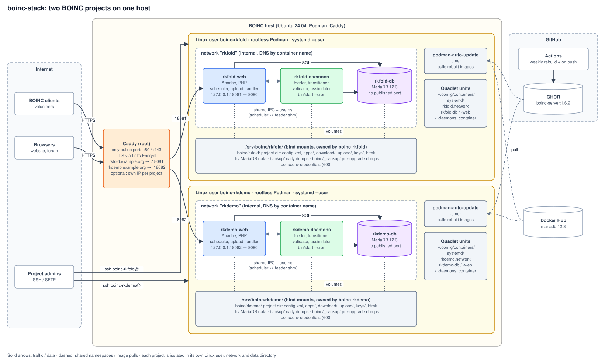

# boinc-stack

Container stack for running one or more **BOINC server projects** on a single host.
It is designed to keep maintenance effort low.

- **One image** (`image/`) for web and daemons: Debian 13, Apache and PHP from Debian,
  BOINC `server_release/1.6.x` built from the official sources.
- **One Linux user per project** with **rootless Podman** and Quadlet/systemd units.
  Project admins can only see and control their own containers.
- **Three containers per project:** `<project>-db` (MariaDB), `<project>-web` (Apache, PHP, scheduler,
  upload handler) and `<project>-daemons` (feeder, transitioner, validator, ...).
- **One central Caddy** (`proxy/`) handles TLS (Let's Encrypt) and routes by hostname.
  Each project can optionally get its own IP.



## Host directories

| Path | Contents |
|---|---|
| `/srv/boinc/<project>/boinc/<project>/` | BOINC project directory (`config.xml`, `apps/`, `download/`, `upload/`, `keys/`, `html/`) |
| `/srv/boinc/<project>/boinc/_backup/` | automatic DB dumps taken before BOINC upgrades |
| `/srv/boinc/<project>/db/` | MariaDB data directory |
| `/srv/boinc/<project>/backup/` | daily DB dumps (`scripts/backup.sh`) |
| `/srv/boinc/<project>/boinc.env` | project and DB credentials (mode 600) |
| `~boinc-<project>/.config/containers/systemd/` | the project's Quadlet units |
| `/etc/caddy/sites/boinc-<address>.caddy` | proxy site per address, generated by `scripts/caddy-sync.sh` (projects on the same address are routed by path) |

Containers are **disposable**. All data lives in the directories above, so images can be
rebuilt and replaced at any time.

## Getting started

Requirements: Ubuntu 24.04 / Debian 12+ with Podman ≥ 4.4 (Quadlet).

```bash
apt install podman caddy gettext-base openssl uidmap
git clone https://github.com/MBlenn/boinc-stack.git /opt/boinc-stack
mkdir -p /etc/caddy/sites && cp /opt/boinc-stack/proxy/Caddyfile /etc/caddy/Caddyfile
systemctl reload caddy

# Test project on the LAN (no TLS)
/opt/boinc-stack/scripts/new-project.sh -n test1 -l "Test project" \
    -u http://192.0.2.10/ -s http://192.0.2.10
```

The first start pulls the images, creates the database and runs `make_project`. This takes
a few minutes. Follow the progress as the project user:

```bash
machinectl shell boinc-test1@
journalctl --user -u test1-daemons -f
```

**Status of all projects:** rootless containers belong to their project users, so `podman ps`
as root shows nothing. `scripts/status.sh` lists the containers of every project
(`-a` includes stopped ones, a project name limits the output to that project).

**Removing a project** (e.g. after a misconfigured test) deletes its user, containers, Caddy
site and data directory. `--keep-data` moves the data to `/srv/boinc/_removed/` instead:

```bash
/opt/boinc-stack/scripts/remove-project.sh -n test1
```

The URL base (`-u`) is written into the project configuration on first start. If it was
wrong, remove the project and create it again.

**Image access:** If the GHCR package `boinc-server` is private, every project user has to
log in once with `podman login ghcr.io`, using a PAT with the `read:packages` scope. It is
simpler to set the package to *public* in the GitHub package settings. The image contains
no secrets.

## Updates

| What | How | Automatic? |
|---|---|---|
| Debian, Apache, PHP (security) | The GitHub Action rebuilds the image weekly under the same tag (`1.6.2`). Each project user's `podman-auto-update.timer` pulls it and restarts the containers. | yes |
| MariaDB patch releases | Tag `12.3` (LTS) is updated upstream and pulled by auto-update | yes |
| MariaDB major version (e.g. 12.3 → next LTS) | Change `Image=` in `<project>-db.container`, then `systemctl --user daemon-reload && systemctl --user restart <project>-db`. `MARIADB_AUTO_UPGRADE=1` upgrades the system tables. Run `backup.sh` first! | no |
| BOINC release | Bump `BOINC_VERSION` in the workflow → new image `:<version>`. For each project, switch `Image=` in web/daemons and restart. The daemons container detects the new release, takes a DB dump and runs `tools/upgrade` (code + DB schema). | no, deliberately per project |

## For project admins

```bash
ssh boinc-<project>@host
systemctl --user status <project>-web <project>-daemons <project>-db
systemctl --user restart <project>-daemons             # restart the daemons
podman exec -it <project>-daemons entrypoint.sh shell  # shell as boincadm in the project directory
#   -> bin/status, bin/stop, bin/start, bin/xadd, bin/update_versions, bin/create_work ...
```

The project name and copyright holder shown on the website come from `PROJECT_LONGNAME` and
`PROJECT_COPYRIGHT` in `/srv/boinc/<project>/boinc.env`. They are written into
`html/project/project.inc` when the project is created. After changing them, apply them with
`podman exec <project>-daemons entrypoint.sh set-names`.

Project files (`apps/`, `config.xml`, `html/project/`) live in `/srv/boinc/<project>/boinc/<project>/`.
They belong to the project user and can be edited directly, e.g. via SFTP.

## Docker apps

The image ships `docker_wrapper` and the tool `boinc-app` to deploy container-based BOINC
apps into a project. The example app `gpucheck` reports whether an NVIDIA GPU is visible inside
the container on the volunteer's host. See [docs/docker-apps.md](docs/docker-apps.md).

## Status

First draft. Tested locally: BOINC 1.6.2 builds; `make_project`, daemons, web and ops login,
scheduler reply, client IP via `X-Forwarded-For` and the upgrade path with a DB dump all
work. The Quadlet units were checked with the Podman 4.9 generator.
**Not yet tested:** building the container image itself, rootless operation with the
shared user/IPC namespace between web and daemons, Caddy.
