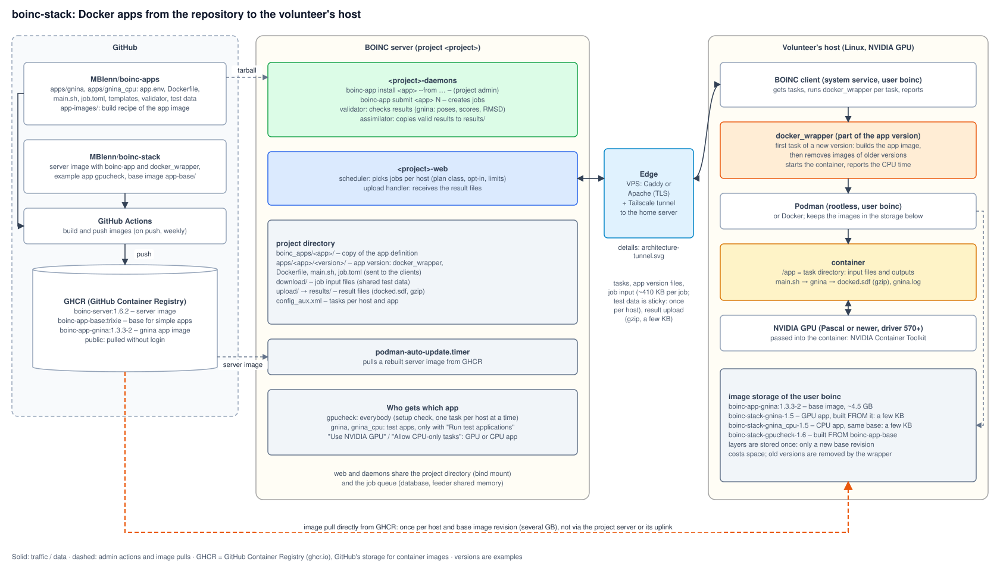

# Docker apps (for project operators)

This page is for project operators. Volunteers find the client setup (Podman, NVIDIA
Container Toolkit, joining a project) in [volunteer-setup.md](volunteer-setup.md).

BOINC 1.6 can ship applications as container images. The volunteer's BOINC client receives
the `docker_wrapper`, a `Dockerfile` and the app files, builds the image locally with
Docker or Podman and runs each job in a container.

The server image of boinc-stack contains:

- `docker_wrapper` for Linux x86_64, statically linked, so it also runs on older distributions
- the example app `gpucheck` under `image/apps/`
- `boinc-app`, which registers an app (plan class, app version, templates, validator and
  assimilator) and creates jobs

Science apps are kept in a separate repository,
[MBlenn/boinc-apps](https://github.com/MBlenn/boinc-apps), together with the CI that builds
their app images. `boinc-app install <app> --from <source>` installs an app from there (or
from any repository or directory with the same layout, see [App format](#app-format)).



Currently supported: **Linux hosts with an NVIDIA GPU**. Windows (WSL) and AMD GPUs are not
covered yet.

## Example app: gpucheck

`gpucheck` checks whether an NVIDIA GPU is visible inside the container and reports
`nvidia-smi` output (GPU name, driver, memory, compute capability). It is the first step
before real GPU workloads. A result like "nvidia-smi: not available" means the job ran,
but the GPU was not passed into the container.

Plan class `docker_nvidia`: only hosts that report Docker/Podman **and** an NVIDIA GPU get these jobs.

A new project has no apps. Install gpucheck and keep a few jobs available, so that new
volunteers can check their setup before they opt in to real workloads (see
[Opt-in for test applications](#opt-in-for-test-applications)). Keep that pool small (a
handful of unsent jobs, topped up now and then): every unsent job takes a slot in the
feeder's buffer, see [Large job batches](#large-job-batches). gpucheck sets
`MAX_IN_PROGRESS=1`, so a host gets one gpucheck task at a time.

### On the server (as the project user)

```bash
podman exec <project>-daemons boinc-app list
podman exec <project>-daemons boinc-app install gpucheck
podman exec <project>-daemons boinc-app submit gpucheck 3
# after the clients have reported:
podman exec <project>-daemons boinc-app results gpucheck
```

`install` can be repeated safely. To deploy changed app files, raise `APP_VERSION` in
`image/apps/<app>/app.env`, rebuild the image and run `install` again. Apps shipped in the
image (like gpucheck) are not updated in the projects automatically: after a server image
update with a new version of such an app, run `boinc-app install <app>` once per project.

### Apps from another repository

```bash
podman exec <project>-daemons boinc-app install gnina --from https://github.com/MBlenn/boinc-apps
podman exec <project>-daemons boinc-app install gnina --from https://github.com/MBlenn/boinc-apps@v1.0
podman exec <project>-daemons boinc-app install myapp --from /path/in/container/myrepo
```

The repository is downloaded as a tarball (branch, tag or commit after `@`, default `main`)
and must contain `apps/<app>/`. `install` copies the app definition into the project
(`<project dir>/boinc_apps/<app>/`, origin and time in `SOURCE`). `submit`, `results` and the
app's server scripts use that copy, so a project keeps working the same way until the app is
installed again. `boinc-app list` shows the installed apps and their origin.

### Volunteers

The client side (Podman for the BOINC user, NVIDIA Container Toolkit, tests, joining the
project) is described in [volunteer-setup.md](volunteer-setup.md). Send new testers that page.

## Why app images must not use RUN

The client runs as a system service (user `boinc`) without a systemd user session. Rootless
Podman falls back to cgroupfs for normal containers, but `RUN` steps during `podman build`
try to create a systemd scope and fail with "Access denied … interactive authentication".
Pulling a base image does not need that, so everything the app needs is put into a base
image on GHCR (`app-base/`, built by the same workflow). The GHCR package `boinc-app-base`
must be public.

## Opt-in for test applications

Apps with `APP_BETA=1` in `app.env` are BOINC **beta apps**: their tasks only go to
volunteers who enabled **"Run test applications?"** in their project preferences; everybody
else only gets the other apps. `boinc-app install` sets the flag in the database (also for
an app that is already installed) and enables **"Run only the selected applications"** in the
project preferences (`APP_SELECT_PREFS` in `html/project/project.inc`).

Recommended setup: `gpucheck` without `APP_BETA` (everybody gets it first), the science apps
(e.g. `gnina`, `gnina_cpu` from boinc-apps) with `APP_BETA=1`. A new volunteer then runs
gpucheck, sees a valid result, and opts in to the real apps afterwards. Volunteers who opt
in get beta tasks first and the other apps when there are no beta tasks.

## CPU and GPU variants of an app

BOINC's project preferences offer "Allow CPU-only tasks" and "Use NVIDIA GPU" (also AMD,
Intel, Apple) as soon as the project has app versions for those resources. The web site
decides by the **plan class name**: names containing `nvidia` or `cuda` count as NVIDIA,
`ati` or `amd` as AMD, everything else as CPU.

To feed CPU and GPU work separately, use two apps with their own plan classes, e.g.
`gnina` (`docker_nvidia_cpu1`) and `gnina_cpu` (`docker_cpu1`, see MBlenn/boinc-apps). A plan
class without `<gpu_type>` reserves no GPU, and `use_gpu = false` in `job.toml` keeps the GPU
out of the container, so a host with one GPU runs a GPU task and CPU tasks side by side.

## Retries on other hosts

New projects get `<one_result_per_host_per_wu>1</one_result_per_host_per_wu>` in
`config.xml`: when a task fails, the replacement task goes to a different host. Without it
(the BOINC default) the same host may get the job again and again until
`max_error_results` is reached. For existing projects, add the line inside `<config>`
(as the project user, `/srv/boinc/<project>/boinc/<project>/config.xml`); the scheduler
reads it with the next request. With a single test host, replacement tasks then wait
until another host asks for work.

## Why does a host get no work?

The scheduler log (`/srv/boinc/<project>/boinc/<project>/log_<project>-web/scheduler.log`;
the scheduler runs in the web container and logs to `log_<hostname>`, see
[Fixed hostname of the web container](#fixed-hostname-of-the-web-container)) only shows "Sending reply ... 0 results" by default. For the reasons, add debug flags inside
`<config>` in `config.xml` (read with the next request, no restart), and remove them later:

```xml
<debug_send/>
<debug_send_scan/>
<debug_send_job/>
<debug_version_select/>
<debug_prefs/>
```

The volunteer also sees the scheduler's messages in the client's event log after "Update"
(e.g. preferences not allowing GPU work, not enough disk space).

Check a volunteer's preferences and host in the database:

```bash
podman exec -it <project>-db sh -c 'mariadb -uroot -p"$MARIADB_ROOT_PASSWORD" <project>'
```

```sql
SELECT id, name, beta FROM app;                         -- which apps are beta (opt-in)
SELECT id, name, project_prefs FROM user WHERE id = 2\G -- <allow_beta_work>1, <no_cuda>, <app_id>
SELECT id, domain_name, serialnum, d_free, d_boinc_max FROM host WHERE id = 2\G
SELECT a.name, COUNT(*) FROM result r JOIN workunit w ON r.workunitid = w.id
  JOIN app a ON w.appid = a.id WHERE r.server_state = 2 GROUP BY a.name;  -- unsent tasks per app
```

In `project_prefs`: `<allow_beta_work>1</allow_beta_work>` = "Run test applications" on;
`<no_cuda>1</no_cuda>` = NVIDIA GPU switched off; `<app_id>` entries inside `<apps_selected>`
= "Run only the selected applications" (no entries = all apps). Preferences stored in a
venue (home, work, school) apply only to hosts in that venue. `serialnum` lists the client
version and the GPUs the host reported; `d_free` and `d_boinc_max` matter for large app images.

Other reasons seen in practice:

- `one_result_per_user_per_wu` set to 1 in `config.xml`: a user then never gets a second
  task of a job, even on another host. With a few testers sharing jobs this starves hosts
  quickly. Keep it at 0 (the default) and use `one_result_per_host_per_wu` instead (see
  [Retries on other hosts](#retries-on-other-hosts)).
- The feeder's buffer is full of jobs of another app, see [Large job batches](#large-job-batches).

## Fixed hostname of the web container

The scheduler and the upload handler run in the web container and write their logs to
`log_<hostname>/` in the project directory. New projects set the hostname
`<project>-web` in the web Quadlet (`--hostname` in `PodmanArgs`, like `<project>-daemons`
for the daemons container). Without it the hostname is the container ID, which changes
with every new container (e.g. after an image update), so each one starts a new log
directory. For an existing project, add `--hostname=<project>-web` to the `PodmanArgs=`
line in `~/.config/containers/systemd/<project>-web.container` of the project user, then
`systemctl --user daemon-reload` and restart the web and daemons units. The old
`log_<container id>/` directories can be deleted.

## Large job batches

**Feeder buffer.** The feeder keeps a buffer of unsent tasks in shared memory (100 slots by
default, `<shmem_work_items>` in `config.xml`), and the scheduler only sends tasks from that
buffer. By default it fills the buffer in database order, so 10,000 unsent jobs of one app
can keep the buffer full while the jobs of another app (e.g. gpucheck) never get a slot,
and hosts that can only run the other app get no work. Remedies:

- keep per-app pools of auxiliary apps small (gpucheck: a handful of jobs) and submit large
  batches in portions (e.g. `boinc-app submit gnina 2000` every few hours instead of 100,000
  at once)
- or start the feeder with `--allapps` (`<cmd>feeder -d 3 --allapps</cmd>` in `config.xml`):
  it then reserves slots for every app, in proportion to the app's `weight` column in the
  `app` table (default 1), e.g. `UPDATE app SET weight = 5 WHERE name = 'gnina';`. Restart
  the daemons afterwards.

**Tasks per host.** `MAX_IN_PROGRESS=N` in `app.env` limits the tasks of an app in progress
per host: `install` writes an entry into `config_aux.xml` (created if missing):

```xml
<config>
    <max_jobs_in_progress>
        <app>
            <app_name>gpucheck</app_name>
            <total_limit><jobs>1</jobs></total_limit>
        </app>
    </max_jobs_in_progress>
</config>
```

An existing entry of the same app is replaced (also a hand-written one, e.g. with
`<gpu_limit>`), other entries are kept. Without `MAX_IN_PROGRESS`, `install` does not touch
the file. The scheduler reads `config_aux.xml` with every request.

**Database size.** Every job leaves rows in `workunit` and `result` after it is finished
(the file deleter only removes the files). For runs of 100,000 jobs and more, add the
`db_purge` daemon, which archives finished jobs to XML files (`archives/`) and deletes them
from the database a while after they are assimilated, e.g. inside `<daemons>`:

```xml
<daemon>
    <cmd>db_purge --min_age_days 7 --gzip --daily_dir</cmd>
</daemon>
```

Purged jobs disappear from the volunteers' task lists on the web site; their credit stays.

## Cancelling jobs

```bash
podman exec <project>-daemons boinc-app cancel <app>
```

cancels all jobs of the app that have neither a valid result nor an error yet (via
`bin/cancel_jobs --name`; `cancel_jobs` with an ID range would also flag finished ones).
Unsent tasks are withdrawn, and clients are told to abort tasks in progress at their next
scheduler request (`send_result_abort` in `config.xml`, set by `make_project`). Results that
are already reported but not yet validated are cancelled as well.

## Where the results are

The job output goes to the output file, not to stderr. `gpucheck` writes the `nvidia-smi`
report to `out`, which is uploaded and copied by the assimilator to
`<project dir>/results/`. Show it with `boinc-app results gpucheck`. The task's stderr only
contains the docker_wrapper log (and the container's stderr, if any).

## App format

An app is a directory `apps/<app>/` (in this repository under `image/apps/`). Start from
`image/apps/gpucheck` or, for an app with input files and its own validator, from `apps/gnina`
in boinc-apps:

| File | Purpose |
|---|---|
| `app.env` | `APP_NAME`, `APP_TITLE`, `APP_VERSION`, `PLAN_CLASS`; optional `APP_BETA=1` (opt-in), `MAX_IN_PROGRESS=N` (tasks per host, see [Large job batches](#large-job-batches)), `VALIDATOR`, `ASSIMILATOR` |
| `plan_class.xml` | `<plan_class>` block, added to the project's `plan_class_spec.xml` |
| `files/Dockerfile` | image built on the host. The slot directory is mounted at `/app`. **No `RUN` steps**: start `FROM ghcr.io/mblenn/boinc-app-base:trixie` (or another image that already contains everything, including `procps`) and only use `WORKDIR`, `COPY`, `ENV`, `CMD`. |
| `files/job.toml` | docker_wrapper options, e.g. `use_gpu = true`, `image_name` (without `:tag`, see the comment in gpucheck's job.toml) |
| `files/*` | further app files (scripts, binaries). `@APP_VERSION@` is substituted. |
| `templates/in.xml`, `templates/out.xml` | input and output templates for `create_work`. Values set here override `create_work` options, so leave out anything `jobs.py` sets per job (e.g. `rsc_fpops_est`, `max_error_results`). |
| `server/*` (optional) | scripts copied to the project's `bin/` (mode 755), e.g. a validator for `script_validator` |
| `jobs.py` (optional) | `make_jobs(count, rng, stamp, testdata)` returns a list of jobs for `submit`: `{"name": ..., "inputs": [files in testdata/], "options": [create_work options], "args": "command line"}`. Without it, `submit` creates jobs without input files. |
| `testdata/` (optional) | input files referenced by `jobs.py`. They are staged into the download hierarchy under a content-hashed name, once, and shared by all jobs, so every `<file_info>` in `templates/in.xml` needs `<no_delete/>` (otherwise the file deleter removes a file after the first job and later jobs fail with download errors; `install` warns about it, `boinc-app stage <app>` restores missing files). |

`app.env` may also set the daemon command lines (defaults shown):

```
VALIDATOR=sample_trivial_validator --app <app>
ASSIMILATOR=sample_assimilator --app <app>
```

The trivial validator accepts every result, and the sample assimilator copies the output
files to `<project dir>/results/`. Real apps need their own validator, e.g.
`script_validator --app <app> --init_script "<script> files result_id"` with the script in
`server/` (exit 0 = valid, 3 = retry later, anything else = invalid). The arguments only work
with the patched script_validator of this image (`image/boinc-patches/`); unpatched BOINC
calls the script without arguments. The output file paths contain the workunit name
(`<workunit>_<instance>_r<random>_<index>`), so a script that only needs the file paths
(`--init_script <script>` alone passes them) runs on any BOINC server. Changing `VALIDATOR`
or `ASSIMILATOR` and running `install` again replaces the daemon entries in `config.xml`.

The docker_wrapper (from the server image) is part of every app version. After a server
image update with a new wrapper, raise `APP_VERSION` and run `install` again; `install`
warns if an existing app version contains a different wrapper.

Image names: use `image_name = "<prefix>-<app>-@APP_VERSION@"` in `job.toml` (as gpucheck
and the boinc-apps do). After building the image of a new app version on a host, the
wrapper removes the images of older versions of the same app (`<prefix>-<app>-<version>`),
other tags of the base image named in the Dockerfile's `FROM` line and dangling images
(patch `0004` in `image/boinc-patches/`). Images still used by a running task are kept
until the next new version. The client itself only cleans up its own `boinc__…` images.

App images that need more than `boinc-app-base` (binaries, libraries) are built in CI and
pulled by the clients; the app's `files/Dockerfile` then only contains `FROM` that image plus
`WORKDIR`, `COPY`, `ENV`, `CMD`. The GHCR package must be public.
