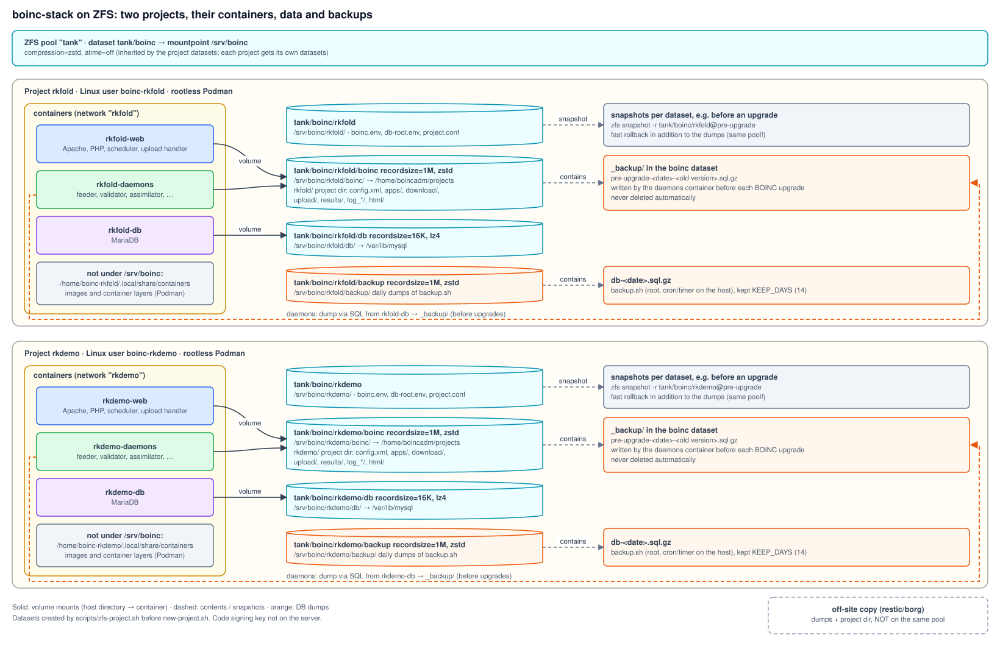

# Projects on ZFS

On a host with ZFS each project can get its own datasets with properties that suit the
data: small records and fast compression for the database, large records and stronger
compression for project files, uploads and dumps. Compression saves disk space on the
server; files that the apps or BOINC already compress (e.g. gzip-compressed results) are
stored as they are, ZFS detects incompressible blocks and gives up on them early.



## Layout

| Dataset | Mountpoint | Properties | Contents | Used by |
|---|---|---|---|---|
| `<parent>/<project>` | `/srv/boinc/<project>` | `compression=zstd`, `atime=off` (inherited by the children) | `boinc.env`, `db-root.env`, `project.conf` | host scripts, Quadlet `EnvironmentFile` |
| `<parent>/<project>/db` | `/srv/boinc/<project>/db` | `recordsize=16K`, `compression=lz4` | MariaDB data | `<project>-db` (`/var/lib/mysql`) |
| `<parent>/<project>/boinc` | `/srv/boinc/<project>/boinc` | `recordsize=1M` | project directory, uploads, results, logs, `_backup/` (dumps before BOINC upgrades) | `<project>-web`, `<project>-daemons` (`/home/boincadm/projects`) |
| `<parent>/<project>/backup` | `/srv/boinc/<project>/backup` | `recordsize=1M` | daily dumps of `scripts/backup.sh` | host (root) |

The mountpoints are always under `DATA_ROOT` (default `/srv/boinc`), so all host scripts
find the project as usual. The admin only chooses the parent dataset.

## Creating a project

Once, the parent dataset:

```bash
zfs create -o mountpoint=/srv/boinc -o compression=zstd -o atime=off tank/boinc
```

Per project, as root, **before** `new-project.sh`:

```bash
./scripts/zfs-project.sh -n rkfold -d tank/boinc --dry-run   # show the zfs commands
./scripts/zfs-project.sh -n rkfold -d tank/boinc
./scripts/new-project.sh -n rkfold -l "Rechenkraft Folding" -u https://rkfold.example.org/ -s rkfold.example.org
```

`zfs-project.sh` creates the four datasets and writes `/etc/boinc-stack/zfs/<project>.conf`
(directory: `ZFS_CONF_DIR`), which lists the datasets. If this file exists, `new-project.sh`
checks that the datasets are mounted at `/srv/boinc/<project>` and empty, and creates the
project there; without it, it creates plain directories as before.

`remove-project.sh` destroys the datasets (with all snapshots), or with `--keep-data`
renames them to `<parent>/_removed_<project>_<timestamp>`, mounted under
`/srv/boinc/_removed/`. The conf file is renamed to `<project>.conf.removed-<timestamp>`.

Existing projects can be moved to datasets later: stop the project's units, create the
datasets under a temporary mountpoint, copy the data (`rsync -aHAX`), swap the mountpoints.
There is no script for this.

## Snapshots and backups

Snapshots are a fast way back, e.g. before a BOINC or MariaDB upgrade:

```bash
zfs snapshot -r tank/boinc/rkfold@pre-upgrade-$(date +%Y%m%d)
zfs list -t snapshot -r tank/boinc/rkfold
```

They live in the same pool, so they do not replace the dumps (`_backup/`, `backup/`) and an
off-site copy (restic/borg, `zfs send` to another machine).

For a consistent rollback, stop the project's units first and roll back the `db` and
`boinc` datasets to the same recursive snapshot, one dataset at a time
(`zfs rollback tank/boinc/rkfold/db@pre-upgrade-…`, then `…/boinc@…`). `zfs rollback`
only goes back to the latest snapshot of a dataset unless `-r` is given, which deletes
the newer snapshots.

## Podman storage

Images and container layers are not under `/srv/boinc` but in the home directory of the
project user (`~boinc-<project>/.local/share/containers`). If `/home` is on ZFS as well,
rootless Podman's overlay storage needs OpenZFS 2.2 or newer; with older versions, keep
`/home` on ext4/xfs or use `fuse-overlayfs`.

## Not set

`innodb_doublewrite=0` (often used on ZFS, which never writes torn pages) is not set; it
would be a start argument in the db Quadlet and should be tested first.
